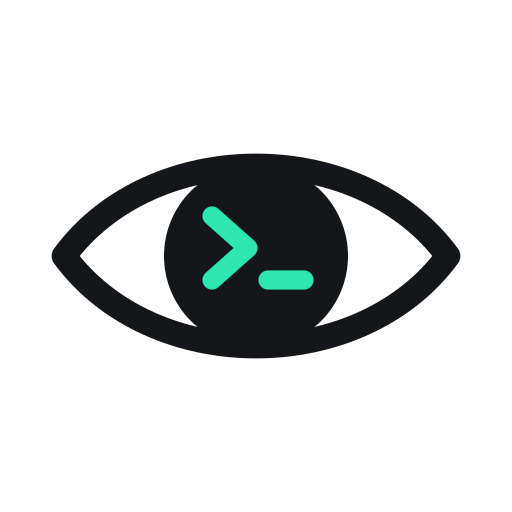
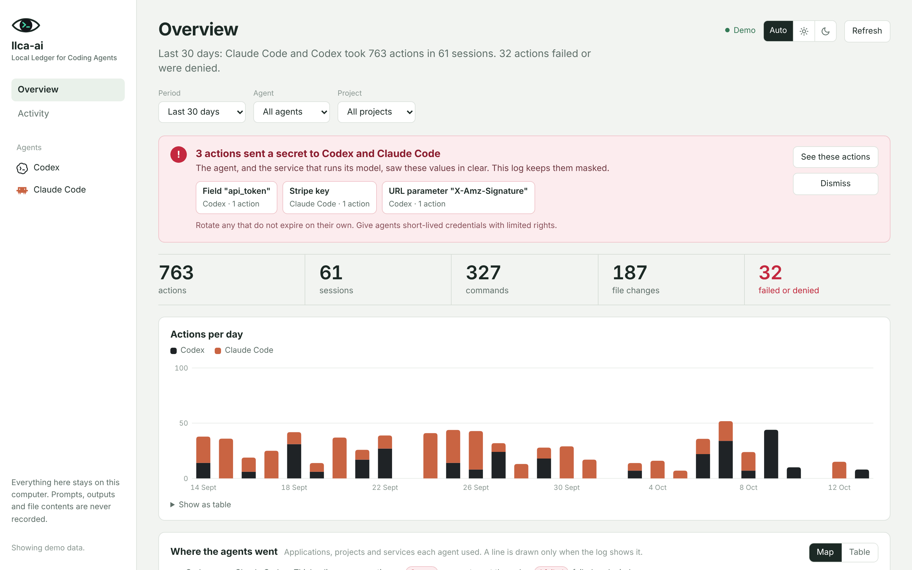
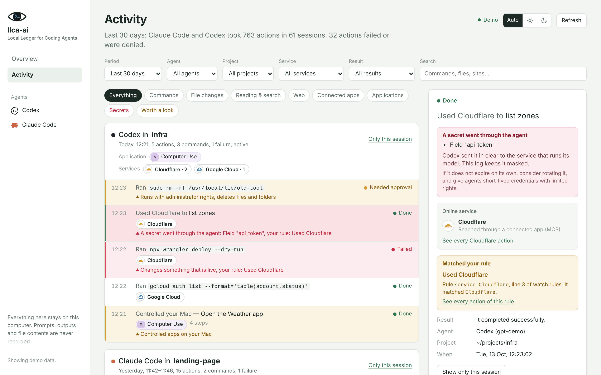
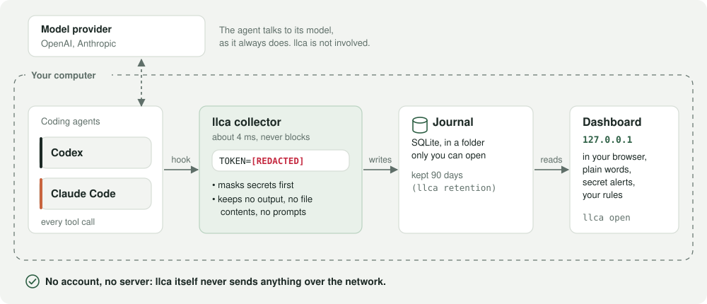
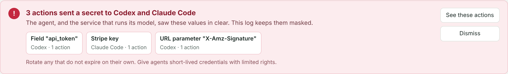
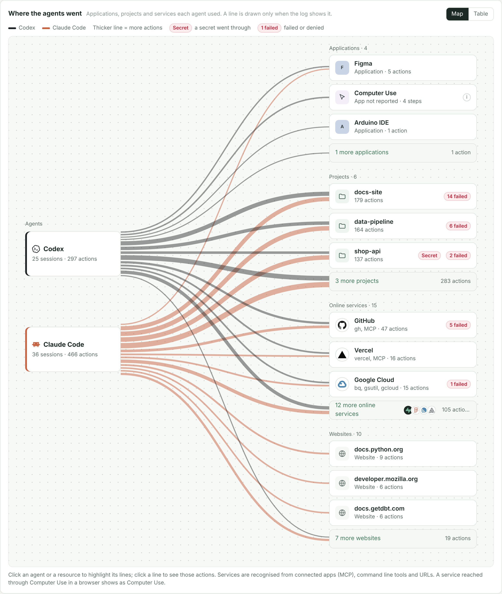
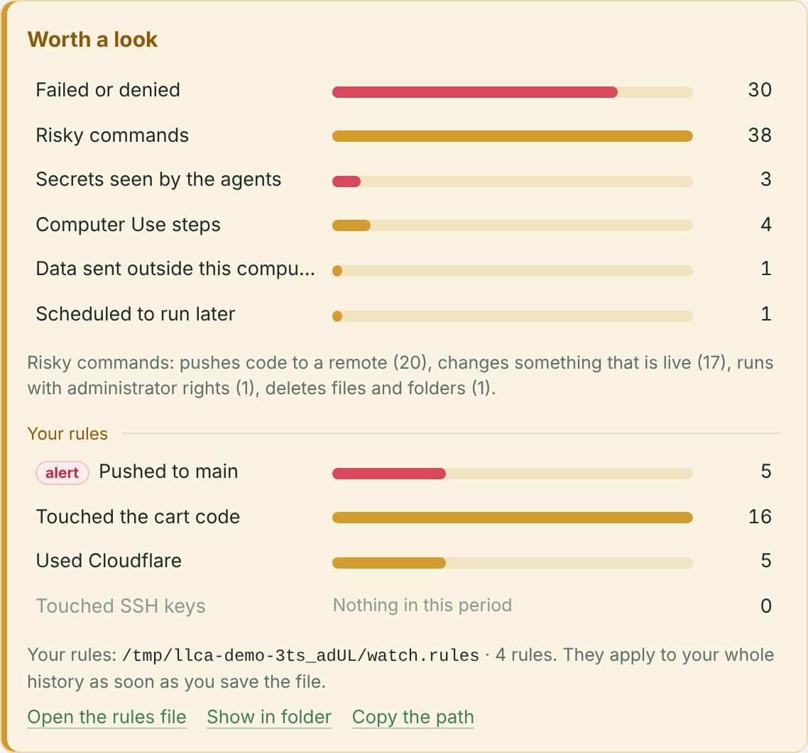

<p align="center"><picture>
  <source media="(prefers-color-scheme: dark)" srcset="assets/llca-logo-dark.svg">
  
</picture></p>

<h1 align="center">llca</h1>

<p align="center"><b>Local Ledger for Coding Agents</b><br>
A local, private log of what <b>Codex</b> and <b>Claude Code</b> do on your machine, in plain words, with a dashboard.</p>

<p align="center"><a href="https://llca-ai.github.io/llca/">Live demo</a> • <a href="#install">Install</a> • <a href="#how-it-works">How it works</a> • <a href="#a-tour-of-the-dashboard">Dashboard tour</a> • <a href="#what-is-kept-and-what-is-not">What is kept</a> • <a href="SECURITY.md">Security</a> • <a href="CHANGELOG.md">Changelog</a></p>

<p align="center"><a href="https://github.com/llca-ai/llca/actions/workflows/ci.yml"></a>
<a href="https://github.com/llca-ai/llca/releases"></a>
<a href="LICENSE"></a>
<a href="#install"></a></p>

<picture>
  <source media="(prefers-color-scheme: dark)" srcset="assets/screenshots/overview-dark.png">
  
</picture>

<picture>
  <source media="(prefers-color-scheme: dark)" srcset="assets/screenshots/activity-dark.png">
  
</picture>

**[Try the live demo](https://llca-ai.github.io/llca/)**: the real dashboard with sample data, in your browser, nothing to install.

Coding agents run commands, edit files, call online services and sometimes see your secrets. llca records the tool calls they report through their hooks, masks recognised secrets **before** anything is written, and shows it all in a dashboard on your own computer. One binary, no account, and llca sends nothing anywhere. Runs on **macOS** and **Linux**, and more agents are coming.

## Supported agents

| Agent | Status | Hooks file |
|---|---|---|
| Codex | ✓ Supported | `~/.codex/hooks.json` |
| Claude Code | ✓ Supported | `~/.claude/settings.json` |
| Cursor / Gemini CLI / Copilot CLI | Next | — |

## What you get

- **Every action in plain words.** "Ran `npm test`", "Edited `src/app.js`", "Used GitHub to create pull request", grouped by session, with a result for each.
- **Secrets masked before they are stored**, and an alert when llca detected one in an agent's activity, so you know what to rotate.
- **Where the agents went**: the projects, applications, online services and websites each agent reached.
- **Worth a look**: failures, risky commands, Computer Use, data sent outside your computer, and **your own rules** ("touched production", "read a `.env` file").
- **The minimum, kept locally**: never prompts, command output or file contents. Events are deleted after 90 days by default.

llca is a security and audit log, not a debugger. To replay full Claude Code transcripts, tokens and costs, use a debugging tool that reads them, such as [claude-devtools](https://github.com/matt1398/claude-devtools).

## Install

With Homebrew, on macOS or Linux (it installs the prebuilt binary of the latest release in a few seconds, no Rust needed):

```sh
brew install llca-ai/tap/llca
llca init --global               # hooks for Codex and Claude Code (those on this computer)
llca doctor                      # checkup: what works, what to fix
llca open                        # the dashboard, until Ctrl+C
```

**Verify.** `llca --version` prints the version; `llca doctor` checks each agent, the collector and the journal. A healthy install looks like this (shortened):

```
$ llca --version
0.7.7

$ llca doctor
llca 0.7.7 · checkup

  ✓ Codex        Recording · last event just now
  ✓ Claude Code  Recording · last event just now
  ✓ Collector    0.7.7, up to date
  ✓ Journal      2 events in 2 sessions · last one just now

All good.
```

Right after `init`, an agent shows `!` ("nothing received yet") until it has run one tool call: start a new session and ask it to run `pwd` (for Codex, trust the hooks first, see below).

Codex asks you to trust new hooks: open `/hooks` in Codex once. Hooks apply to sessions started afterwards. To look around first, `llca demo` opens the dashboard on sample data, kept apart from your log.

To upgrade: `brew upgrade llca`, then `llca init --global` again, so that the hooks use the new version (`llca doctor` reminds you).

<details>
<summary><b>Other ways to install</b>: install script, prebuilt binary, from source</summary>

**Install script (Linux, macOS).**

```sh
curl -fsSL https://raw.githubusercontent.com/llca-ai/llca/main/install.sh | sh
```

It downloads the release for your system, verifies its SHA-256 and installs `llca` to `~/.local/bin` without `sudo`. Tip: read the script first, and pin a version with `LLCA_VERSION=0.7.7` if you want a reproducible install.

**Prebuilt binary.** Each [release](https://github.com/llca-ai/llca/releases) has an archive for macOS (Apple silicon and Intel) and Linux (x86_64 and arm64), with its SHA-256. Unpack it and put `llca` on your `PATH` (the install script above does this for you). On Linux it needs the system SQLite library, present on most systems. On macOS, a binary downloaded with a browser is blocked by Gatekeeper because it is not signed: use Homebrew, or `curl` to download it.

**From source.** You need Rust and, on macOS, the Xcode Command Line Tools (`xcode-select --install`); on Linux, a C toolchain and the SQLite development files (`build-essential libsqlite3-dev` on Debian and Ubuntu, `gcc sqlite-devel` on Fedora, `base-devel sqlite` on Arch).

```sh
cargo build --release            # → target/release/llca
./target/release/llca demo
```
</details>

## Uninstall

```sh
llca uninstall --global          # removes the hooks and, once unused, the collector copy; keeps the journal
brew uninstall llca              # installed with Homebrew
rm ~/.local/bin/llca             # installed with the install script
```

To delete the journal too, remove the data folder: `~/Library/Application Support/llca` on macOS, `~/.local/share/llca` on Linux.

## How it works

Each agent calls llca through its hooks, around every tool call it reports. llca never blocks, allows or changes anything: it only writes down what happened.

<picture>
  <source media="(prefers-color-scheme: dark)" srcset="assets/how-it-works-dark.svg">
  
</picture>

- **Hooks.** `init` adds them to `~/.codex/hooks.json` and to `~/.claude/settings.json` (or to one project with `--project`), keeping your settings, any hooks you already have, the file's indentation, and a backup. A file that already has llca's hooks is left untouched.
- **The collector** reads the event, masks secrets, appends it to SQLite and exits. It adds about 4 ms per hook. If something goes wrong, it notes it in `collector-errors.log` and lets the agent go on.
- **The hooks call a copy** of llca in its data folder, so that upgrading or moving llca never breaks them. After an upgrade, run `llca init --global` again; `doctor` and the dashboard tell you when the copy is behind.
- **The dashboard** is a small server on `127.0.0.1`, protected by a token created at each launch. It runs until Ctrl+C.

## A tour of the dashboard

Two pages share one row of filters (period, agent, project): the **Overview**, with key figures, actions per day and the cards below, and **Activity**, the detailed list. Every figure and row on the overview opens the matching actions.

**Secrets seen by the agents.** When llca masks a secret, it records its kind ("GitHub token", "URL parameter \"sig\""), never its value. The overview then opens with an alert listing the kinds, the agents and the actions involved, and suggests rotating long-lived credentials. **Dismiss** hides it until a new secret arrives.

<picture>
  <source media="(prefers-color-scheme: dark)" srcset="assets/screenshots/alert-dark.png">
  
</picture>

**The activity list** tells the story in plain words, grouped by session, with the files changed, the applications and the online services used. On macOS, **Computer Use** (the agent operating your apps) shows as "Controlled your Mac — <step>".

<picture>
  <source media="(prefers-color-scheme: dark)" srcset="assets/screenshots/activity-dark.png">
  
</picture>

**Where the agents went.** A map links each agent to the applications, projects, online services and websites it reached, with a line as thick as the number of actions. A service is recognised from a command line tool (`gcloud`, `gh`, `stripe`…), a connected app (MCP) or a URL's domain, using [`rules/services.rules`](rules/services.rules). Click a line to see those actions.

<picture>
  <source media="(prefers-color-scheme: dark)" srcset="assets/screenshots/map-dark.png">
  
</picture>

**Worth a look** lists failures, denials, secrets, Computer Use, risky commands (sudo, recursive deletes, git push, piping a download into a shell, deploying), data sent outside your computer and work scheduled to run later. These flags are simple heuristics, not a security verdict.

<picture>
  <source media="(prefers-color-scheme: dark)" srcset="assets/screenshots/worth-dark.png">
  
</picture>

### Your rules

To notice what matters to *you*, write one line per thing to watch in `watch.rules` (`init` creates it with examples; "Open the rules file" in "Worth a look" opens it):

```
file      .env                          # Touched a .env file
alert command kubectl * --context prod  # Touched production
tool      mcp__*gmail*__send*           # Sent an email
service   Stripe                        # Used Stripe
```

`file` matches a path, `command` a shell command, `tool` a tool name, `service` an online service. `*` matches anything and case is ignored. Matches show under "Your rules" (red with `alert`) and become a filter in the activity list. Rules only flag what is already in the journal: they never block an agent, and they apply to your whole history as soon as you save the file.

## What is kept, and what is not

| Kept | Not kept |
|---|---|
| agent<br>session<br>tool name<br>the command or arguments, with secrets masked<br>file paths<br>working folder<br>time<br>the result (exit code, success) | prompts<br>model replies<br>tool output<br>file contents<br>patches and the text of edits<br>heredocs<br>text typed into a running process |

What is not kept becomes `[CONTENT NOT KEPT]`.

**Secrets** are replaced by `[REDACTED]` before anything is written: secret-named fields and options (`password`, `--token`, `API_KEY=…`), credential headers, signed URL parameters (`sig`, `X-Amz-Signature`…), private keys, credentials in URLs, and about 30 known token formats (OpenAI, Anthropic, GitHub, AWS, Google, Stripe, Slack…). The rules are in [`rules/redaction.rules`](rules/redaction.rules), a plain-text file, and each is proven by a case in [`rules/cases.txt`](rules/cases.txt).

Redaction is best-effort: a format no rule knows can slip through. `llca audit` lists kept values that look random, with the rule that would mask them, and `llca redact` applies new rules to events already recorded. To add a rule, see [CONTRIBUTING.md](CONTRIBUTING.md): one line, one test case, no Rust needed.

Masking protects the journal; it does not take a secret back from the agent. If a value appeared in a tool call, the agent had it, and so did the service that runs its model.

**Retention.** Events older than 90 days are deleted and their text is overwritten in the file. `llca retention 30` keeps 30 days, `llca retention off` keeps everything.

**Where the data lives.** On macOS, `~/Library/Application Support/llca/`; on Linux, `~/.local/share/llca/` (or `$XDG_DATA_HOME/llca/`). `LLCA_HOME` or `--data-dir` choose another folder. Files are private to your user; the database is not encrypted.

## Commands

```sh
llca init --global [--agent codex|claude|all]      # default: the agents found on this computer
llca init --project /path/to/project [--agent …]   # hooks for one project only
llca doctor [--json]                               # checkup: what works, what to fix
llca open [--port N] [--no-browser]                # dashboard, until Ctrl+C
llca demo                                          # dashboard with sample data
llca logs [--json] [--search TEXT] [--agent …]     # recorded events in the terminal
llca audit                                         # kept values that look like secrets
llca redact                                        # apply today's redaction to recorded events
llca retention [DAYS | off]                        # how long events are kept (default: 90 days)
llca uninstall --global [--agent …]                # removes the hooks (and the collector copy once unused), keeps the journal
```

## Limits

- llca sees what the agents' hooks report. Hosted tools (such as Codex's web search) do not go through hooks, nor does most input sent to a process that is already running.
- It sees a command, not what happens inside it: the files a script opens or the servers it calls are not recorded.
- Permission requests are logged, but neither agent reports your final decision.
- Only local sessions run hooks: cloud-run sessions and the ChatGPT and Claude chat apps are not observed.
- The journal is not tamper-proof evidence and llca is not a security control. It does not replace a sandbox or scoped credentials.

## FAQ

**Does llca slow my agent?** About 4 ms per hook. If something goes wrong, llca notes it in `collector-errors.log` and lets the agent go on.

**Can it block a command?** No. It never blocks, allows or changes anything: it only writes down what happened.

**Does it send anything anywhere?** No. There is no account and no telemetry, and the dashboard listens on `127.0.0.1` only.

**Can an agent tamper with the log?** Yes, technically: the agent runs as your user. That is why the journal is not tamper-proof evidence and llca is not a security control (see [Limits](#limits)).

## Development

```sh
cargo test                 # unit and end-to-end tests, including every case in rules/cases.txt
cargo clippy --all-targets -- -D warnings
cargo fmt
```

llca is written in Rust with no third-party crates; it links the system SQLite library. CI runs these checks on macOS and Linux for every push and pull request.

Found a secret that slipped through, or another security issue? See [SECURITY.md](SECURITY.md) and please report it privately.

llca is released under the [MIT licence](LICENSE). Service logos are trademarks of their owners, shown only to identify each service.

Protocol references: [Codex hooks](https://learn.chatgpt.com/docs/hooks) and [Claude Code hooks](https://code.claude.com/docs/en/hooks).
